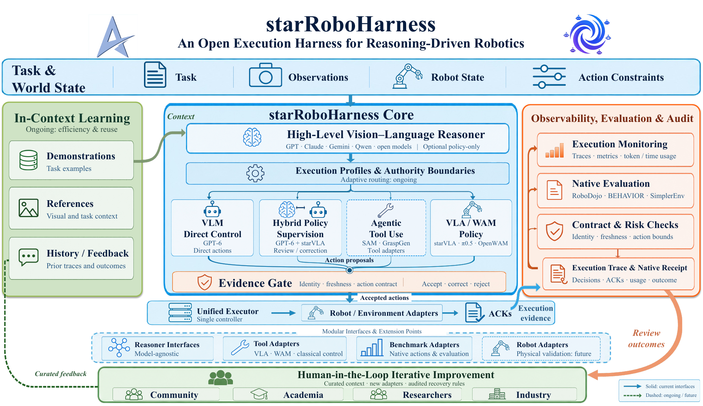
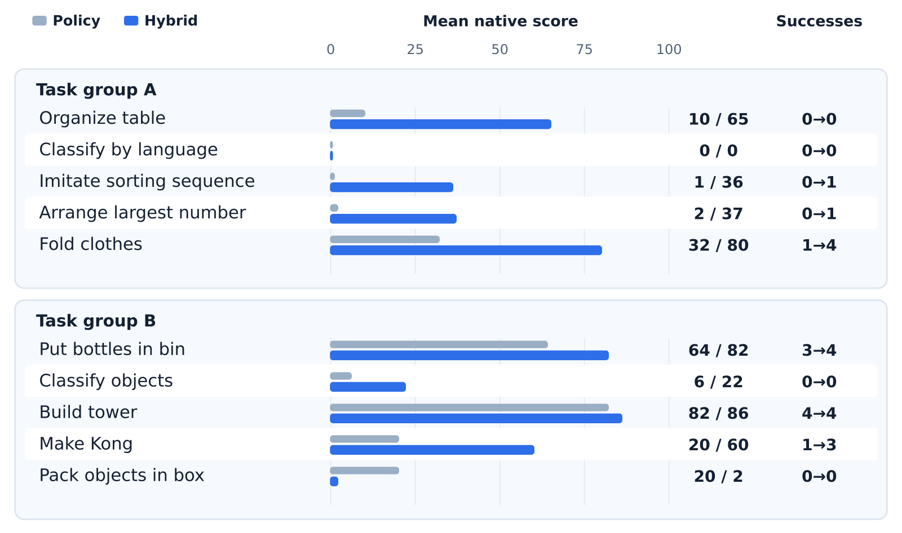
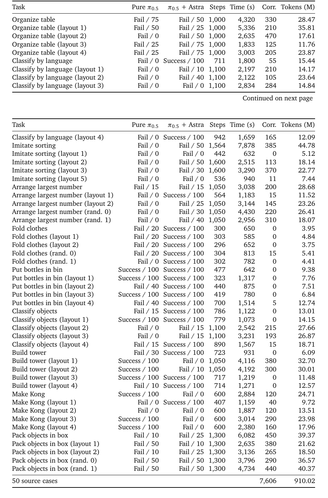

<p align="left">
  
</p>

<h1 align="center">
  <br />
  starRoboHarness
</h1>

<p align="center"><strong>An auditable, model-neutral harness for reliable and efficient robot-policy execution.</strong></p>

<p align="center">
  <a href="https://huggingface.co/datasets/JackAILab/starRoboHarness">🤗 Hugging Face</a> ·
  <a href="https://jackailab.github.io/Projects/starRoboHarness/">🌐 Homepage</a> ·
  <a href="README.zh-CN.md">🇨🇳 中文文档</a> ·
  <a href="assets/paper/starRoboHarness_tech_report.pdf">📄 Paper</a>
</p>

starRoboHarness connects a robot policy, a reasoner, and an environment through one explicit control contract:

```text
Observation → Proposal → Evidence gate → Decision → One controller → Native receipt
```

The harness keeps policy adapters, reasoner transports, simulator integrations, execution guards, and evaluation receipts separate. A policy can stay frozen, a reasoner can be replaced, and the native environment remains the authority for success.

## 🔥 What's new

- 📢 **[2026/10/11]** Released the starRoboHarness technical paper and the public release structure.
- 🔥 **[2026/09/26]** Added broader benchmark contracts and a more stable evaluation pipeline.
- 🔥 **[2026/09/19]** Open-sourced starRoboHarness.

## 🧭 Framework

<p align="center"></p>

The reasoner is a bounded decision-maker. A proposal is checked for freshness and action bounds before execution. The environment adapter owns episode progression, the controller records acknowledgements, and the native evaluator supplies the terminal outcome. The editable framework source is [`framework.pptx`](assets/figures/framework.pptx); the publication export is [`framework.pdf`](assets/figures/framework.pdf).

## ⚙️ Quick start

```bash
git clone https://github.com/starVLA/starRoboHarness.git
cd starRoboHarness
bash scripts/bootstrap.sh
python -m pip install -e '.[dev]'
pytest -q
```

The default installation contains the lightweight contracts and tests. Heavy simulators, checkpoints, and provider SDKs stay behind optional adapters. Read [`docs/deployment.md`](docs/deployment.md) before launching an environment.

## 🗂️ Repository layout

```text
starRoboHarness/
├── src/starharness/       # stable contracts, adapters, reasoners, rollout
├── configs/               # versioned evaluation and runtime manifests
├── examples/              # small, runnable integration examples
├── scripts/               # preflight, launch, audit, queue, and reporting tools
├── tests/                 # contract and integration tests
├── docs/                  # architecture, protocols, benchmark, and operations
├── assets/                # logos, figures, paper, and release assets
├── UI/                    # read-only local monitor and dashboard
└── benchmarks/            # benchmark contracts and result index
```

Simulation and real-robot integrations stay behind adapters. New integrations should add a backend-specific module and a contract test rather than importing simulator code into the core package. See [`docs/repository_layout.md`](docs/repository_layout.md) and [`docs/design_principles.md`](docs/design_principles.md).

## 🧪 Examples and live dashboard

A minimal contract loop is in [`examples/minimal_loop.py`](examples/minimal_loop.py). To start the local read-only dashboard over a campaign directory:

```bash
./UI/run-dev.sh /path/to/campaign
# then open http://127.0.0.1:8766
```

The dashboard reads evidence and serves task progress, camera frames, public decision records, and native receipts. It does not launch, stop, replay, or edit an evaluation. See [`docs/live_dashboard.md`](docs/live_dashboard.md) for remote port forwarding.

## 📊 RoboDojo results

The figure below is the archived RoboDojo development comparison used by the technical report. It shows task-level native scores and completion counts for matched policy and hybrid configurations. It is included as a visual result record; the final paper and evidence ledger define the exact panel, denominator, and exclusions.

<p align="center"></p>

The editable source is [`robodojo-results.svg`](assets/figures/robodojo-results.svg). The complete archived 50-case scene index from Table 12 is shown below and is also available in the [benchmark results guide](docs/benchmark_results.md).

<p align="center"></p>

Raw rollout evidence and private operational logs remain outside the public repository.

## 🧩 Benchmark coverage

The public tree records the contracts and entry points that are safe to reproduce. Current adapters cover RoboDojo and include a fail-closed VLAct contract check. Development integrations for RoboTwin 2.0, LIBERO-Pro, RoboCasa 365, BEHAVIOR, and SimplerEnv are documented with their scope and limitations in [`docs/benchmark_results.md`](docs/benchmark_results.md) and [`docs/vlact.md`](docs/vlact.md). A diagnostic or simulator smoke result is never presented as a full benchmark score.

## 🤖 Real-robot support

The core package is hardware-neutral. Real-robot drivers belong in adapters that implement observation, action, safety-stop, clock, and native-receipt contracts. The public release documents the interface and current support boundary in [`docs/real_robot_support.md`](docs/real_robot_support.md); it does not claim a physical-robot score without a native receipt.

## 📄 Paper and citation

The technical paper is available as [`starRoboHarness_tech_report.pdf`](assets/paper/starRoboHarness_tech_report.pdf).

If you find our ideas or environments helpful, please cite our work:

```bibtex
@article{starroboharness2026,
  title   = {starRoboHarness: A Community-Driven Efficiency Harness Infra for Uniting Robot Policy},
  author  = {{starRoboHarness Team}},
  journal = {Technical report},
  year    = {2026},
  url     = {https://github.com/starVLA/starRoboHarness}
}
```

## 🤝 Acknowledgements

We build on the open-source work of [**StarVLA**](https://github.com/starVLA), [**RoboDojo**](https://github.com/JackAILab/starRoboDojo), [**RoboTwin**](https://github.com/robotwin), [**LIBERO**](https://github.com/Lifelong-Robot-Learning/LIBERO), [**RoboCasa**](https://github.com/robocasa), [**robosuite**](https://github.com/ARISE-Initiative/robosuite), [**MuJoCo**](https://mujoco.org/), and [**OpenPI**](https://github.com/Physical-Intelligence/openpi). We also thank the broader robot-learning community for maintaining the environments, policies, and evaluation interfaces used by this project.

## 🙌 Contributing

Contributions are welcome for adapters, evaluation protocols, diagnostics, documentation, and dashboard improvements. Start with [`CONTRIBUTING.md`](CONTRIBUTING.md). Every benchmark change must state its protocol, denominator, seed, checkpoint identity, commit, and evidence location. Do not commit credentials, checkpoints, datasets, raw trajectories, or cluster paths.

## 📜 License

MIT. Third-party components and their licenses are listed in [`THIRD_PARTY_NOTICES.md`](THIRD_PARTY_NOTICES.md).
